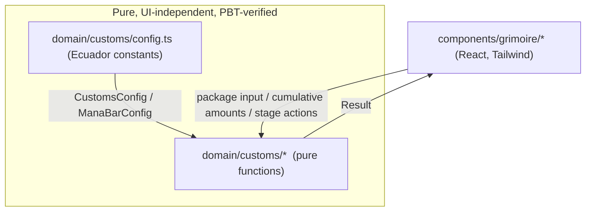
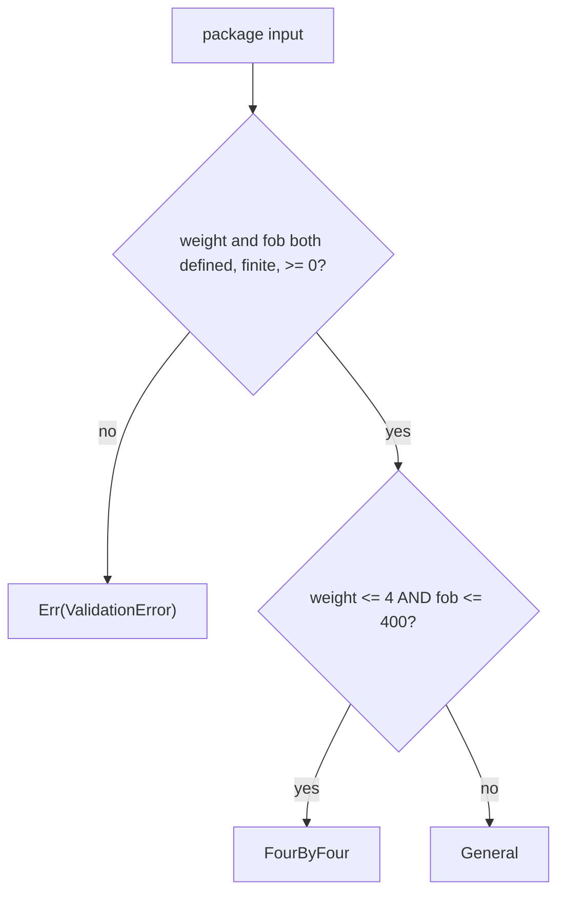
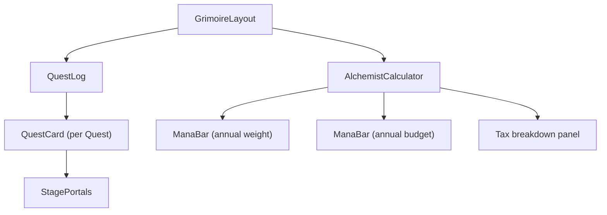

# Design Document

## Overview

This design specifies the customs-grimoire feature for PhantasmTrack (GrimCourier): a gothic dark-fantasy grimoire for tracking cross-border packages ("Quests"). It covers three capability areas defined in the requirements:

1. **Alchemist Customs Calculator** — selects Ecuador's simplified 4x4 import regime or the general import regime and computes taxes and fees for a single package (Requirements 1–4).
2. **Annual Mana Bars** — compute cumulative annual weight and import-budget usage percentages against configured limits and classify each into a threshold status (Requirements 5–7).
3. **Quest Tracker** — manages a package's lifecycle across the arcane stages Origin Portal → Customs Abyss → Guild Delivery (Requirement 8).

The guiding architectural principle, from `.kiro/steering/structure.md`, is a strict separation between **pure domain logic** (`src/domain/customs/`) and **presentational UI** (`src/components/grimoire/`). All calculation, validation, and state-transition logic lives in the domain layer with **no React or UI imports**, so it is 100% verifiable in isolation with Property-Based Testing (Vitest + fast-check). The UI is a thin, atmospheric layer that consumes domain functions and never reimplements them.

All monetary values are USD; all weights are kg. All monetary outputs are rounded to the nearest cent (0.01 USD).

### Key Design Decisions

- **Result type over exceptions.** Every fallible domain function returns a discriminated `Result<T, ValidationError>` rather than throwing. This makes error paths (Requirements 1.5, 2.5, 3.5, 4.4, 4.5, 5.5, 6.5, 7.5, 7.6, 8.4, 8.5, 8.6) explicit, total, and trivially testable with fast-check, and it keeps the UI from needing try/catch around calculations.
- **Configuration is injected, not hard-coded in logic.** Rates, limits, and fees flow in through a `CustomsConfig` object. Ecuador defaults are provided as named constants but the calculator never reads globals, preserving determinism (Requirement 4.1) and testability.
- **Pure, dependency-free domain functions.** Each function is a pure function of its arguments. No clocks, randomness, I/O, or React. This directly satisfies the "verified in isolation" intent of Requirements 4 and 7.
- **Shared mana-bar primitive.** The annual weight bar and annual budget bar share one `computeManaBar(cumulative, limit)` function and one `manaBarStatus(usagePercentage)` classifier, since Requirements 5, 6, and 7 describe identical math and thresholds over different quantities.

## Architecture

```
src/
  app/
    page.tsx                     # Composes the grimoire; client state only
  components/
    grimoire/                    # Gothic dark-fantasy UI (consumes domain, no math)
      GrimoireLayout.tsx
      QuestLog.tsx
      QuestCard.tsx
      StagePortals.tsx
      AlchemistCalculator.tsx
      ManaBar.tsx
  domain/
    customs/                     # Pure logic — NO React / NO UI imports
      types.ts                   # Domain types & Result/ValidationError
      config.ts                  # Ecuador constants & default CustomsConfig
      regime.ts                  # selectRegime
      calculator.ts              # calculateCustoms
      manaBar.ts                 # computeManaBar, manaBarStatus
      quest.ts                   # createQuest, advanceQuest, setQuestStage
      index.ts                   # Barrel re-exports
  __tests__/
    customs/                     # Vitest + fast-check property suites
      regime.property.test.ts
      calculator.property.test.ts
      manaBar.property.test.ts
      quest.property.test.ts
```

### Layered Data Flow



The arrows crossing into `PURE` are plain values only. The domain layer never imports from `components/` or `app/`; dependencies point one way (UI → domain), which is what lets the test suite exercise the domain with no DOM or React runtime.

### Regime Selection Decision



## Components and Interfaces

### Domain layer — pure function signatures (`src/domain/customs/`)

All signatures are UI-free and total (they never throw for in-domain inputs; invalid inputs yield `Err`).

**`regime.ts`**

```typescript
// Selects the applicable regime for a validated package input.
// Pure; assumes caller inputs are already finite/non-negative, OR returns Err
// for missing fields per Requirement 1.5.
export function selectRegime(
  input: PackageInput,
  config: CustomsConfig
): Result<ImportRegime, ValidationError>;
```

**`calculator.ts`**

```typescript
// Full customs computation: validates input and config, selects regime,
// computes tariff/VAT/flat fee/total, rounds every monetary amount to cents.
// Requirements 1–4.
export function calculateCustoms(
  input: PackageInput,
  config: CustomsConfig
): Result<TaxResult, ValidationError>;
```

**`manaBar.ts`**

```typescript
// Generic annual mana-bar computation shared by the weight bar and the budget
// bar. Computes usagePercentage = cumulative / limit * 100 (no upper cap) and
// classifies status. Requirements 5, 6, 7.
export function computeManaBar(
  cumulative: number,
  limit: number
): Result<ManaBarResult, ValidationError>;

// Pure threshold classifier. Assumes usagePercentage >= 0.
// Requirements 5.2–5.4, 6.2–6.4.
export function manaBarStatus(usagePercentage: number): ManaBarStatus;
```

**`quest.ts`**

```typescript
// Requirement 8.1: a new Quest starts at OriginPortal.
export function createQuest(id: string, label: string): Quest;

// Requirement 8.2–8.4: advance one step along the ordered sequence;
// advancing the terminal stage is an error and retains the stage.
export function advanceQuest(stage: QuestStage): Result<QuestStage, ValidationError>;

// Requirement 8.5–8.6: a targeted stage change succeeds only when `target`
// is the immediate successor of `current`; otherwise reject and retain `current`.
export function setQuestStage(
  current: QuestStage,
  target: QuestStage
): Result<QuestStage, ValidationError>;
```

### UI layer — component hierarchy (`src/components/grimoire/`)

The UI is gothic dark-fantasy (deep blacks/purples, glowing arcane accents, `lucide-react` icons, Tailwind keyframe glows). Components are presentational; all numbers they display come from domain functions.



- **`GrimoireLayout`** — top-level atmospheric shell (spellbook framing, background glow). Holds client state (list of `Quest`, current calculator inputs, cumulative annual totals) and passes values down.
- **`QuestLog`** — renders the collection of `QuestCard`s, like entries in an adventurer's log.
- **`QuestCard`** — shows one `Quest`: its label, current `QuestStage`, and an "Advance" action. On click it calls `advanceQuest(quest.stage)` (or `setQuestStage`) and updates state only on `Ok`; on `Err` it surfaces the validation message (e.g. "already at the final stage") without mutating the stage.
- **`StagePortals`** — the three arcane portals **Origin Portal → Customs Abyss → Guild Delivery**, highlighting the active stage. Maps `QuestStage` enum values to portal visuals.
- **`AlchemistCalculator`** — form for `Package_Weight` and `FOB_Value`. On change it calls `calculateCustoms(input, config)`; on `Ok` it renders the regime badge (4x4 vs General) and the tariff/VAT/flat-fee/total breakdown; on `Err` it shows a field-specific validation message.
- **`ManaBar`** — reusable glowing bar. Given a `cumulative` and `limit`, it calls `computeManaBar` and renders the fill width from `usagePercentage` (visual fill clamped to 100% for layout while the numeric readout may exceed 100%), tinting by `status`: `normal` (calm arcane blue), `warning` (amber glow at ≥80%), `limitReached` (pulsing crimson at ≥100%). Used twice: annual weight and annual budget.

**How UI consumes pure domain functions:** components import only from `src/domain/customs` (via its barrel `index.ts`), pass in plain inputs plus a `CustomsConfig`/limit, receive a `Result`, and branch on `result.ok`. No component recomputes a tariff, percentage, or stage transition locally. This keeps every tested invariant authoritative in the UI.

## Data Models

All types live in `src/domain/customs/types.ts`.

### Result and validation error

```typescript
export type Result<T, E> =
  | { readonly ok: true; readonly value: T }
  | { readonly ok: false; readonly error: E };

// Names the offending field so the UI can point to it (Req 1.5, 2.5, 3.5,
// 4.4, 4.5, 5.5, 6.5, 7.5, 7.6, 8.4, 8.5, 8.6).
export type ValidationField =
  | "packageWeight"
  | "fobValue"
  | "flatFee"
  | "adValoremRate"
  | "vatRate"
  | "cumulative"
  | "limit"
  | "targetStage";

export interface ValidationError {
  readonly field: ValidationField;
  readonly code:
    | "missing"
    | "negative"
    | "nonFinite"
    | "invalidStage"
    | "outOfSequence"
    | "alreadyFinal";
  readonly message: string;
}
```

### Customs domain

```typescript
export enum ImportRegime {
  FourByFour = "FourByFour",
  General = "General",
}

// Input fields are optional so the calculator can detect "missing" (Req 1.5).
export interface PackageInput {
  readonly packageWeight?: number; // kg
  readonly fobValue?: number;      // USD
}

export interface CustomsConfig {
  readonly weightLimit: number;    // kg; Ecuador default 4
  readonly fobLimit: number;       // USD; Ecuador default 400
  readonly adValoremRate: number;  // fraction, e.g. 0.10 = 10%
  readonly vatRate: number;        // fraction, e.g. 0.15 = 15%
  readonly flatFee: number;        // USD, applied to every package
}

export interface TaxResult {
  readonly regime: ImportRegime;
  readonly adValoremTariff: number; // USD, rounded to cents, >= 0
  readonly vat: number;             // USD, rounded to cents, >= 0
  readonly flatFee: number;         // USD, rounded to cents, >= 0
  readonly total: number;           // USD, rounded to cents, >= flatFee
}
```

### Mana bar domain

```typescript
export type ManaBarStatus = "normal" | "warning" | "limitReached";

export interface ManaBarInput {
  readonly cumulative: number; // consumed amount for the year (kg or USD), >= 0
  readonly limit: number;      // configured annual limit, > 0
}

export interface ManaBarResult {
  readonly cumulative: number;
  readonly limit: number;
  readonly usagePercentage: number; // >= 0, no upper cap
  readonly status: ManaBarStatus;
}

export interface ManaBarConfig {
  readonly warningThreshold: number;  // percent; Ecuador default 80
  readonly criticalThreshold: number; // percent; Ecuador default 100
}
```

### Quest domain

```typescript
export enum QuestStage {
  OriginPortal = "OriginPortal",
  CustomsAbyss = "CustomsAbyss",
  GuildDelivery = "GuildDelivery",
}

// Canonical ordering used by advanceQuest/setQuestStage (Req 8).
export const QUEST_SEQUENCE: readonly QuestStage[] = [
  QuestStage.OriginPortal,
  QuestStage.CustomsAbyss,
  QuestStage.GuildDelivery,
] as const;

export interface Quest {
  readonly id: string;
  readonly label: string;
  readonly stage: QuestStage;
}
```

### Ecuador configuration constants (`src/domain/customs/config.ts`)

These encode the Ecuador 4x4 rule defaults. Rates are representative and **configurable** — the calculator reads them only through an injected `CustomsConfig`, so deployments can override them without touching logic. A commonly cited starting point for the general regime is a ~10% ad-valorem tariff and Ecuador's standard VAT (historically 12%, 15% more recently); the exact figures are policy inputs, not domain invariants.

```typescript
export const WEIGHT_LIMIT = 4;        // kg  (Four_By_Four_Regime max)
export const FOB_LIMIT = 400;         // USD (Four_By_Four_Regime max)
export const WARNING_THRESHOLD = 80;  // percent
export const CRITICAL_THRESHOLD = 100; // percent

// Representative, configurable rates (fractions). Override per policy.
export const DEFAULT_AD_VALOREM_RATE = 0.10; // 10%
export const DEFAULT_VAT_RATE = 0.15;        // 15%
export const DEFAULT_FLAT_FEE = 42;          // USD courier/customs fee

export const DEFAULT_CUSTOMS_CONFIG: CustomsConfig = {
  weightLimit: WEIGHT_LIMIT,
  fobLimit: FOB_LIMIT,
  adValoremRate: DEFAULT_AD_VALOREM_RATE,
  vatRate: DEFAULT_VAT_RATE,
  flatFee: DEFAULT_FLAT_FEE,
};

export const DEFAULT_MANA_BAR_CONFIG: ManaBarConfig = {
  warningThreshold: WARNING_THRESHOLD,
  criticalThreshold: CRITICAL_THRESHOLD,
};
```

### Rounding convention

A single helper `round2(x) = Math.round(x * 100) / 100` is used for every monetary amount so that tariff, VAT, flat fee, and total each land on a cent boundary (Requirements 3.1, 3.2, 3.4, 4.1). Rounding is applied to each component before summing the total, and the total itself is rounded, keeping outputs stable and comparable across repeated runs.

## Correctness Properties

*A property is a characteristic or behavior that should hold true across all valid executions of a system — essentially, a formal statement about what the system should do. Properties serve as the bridge between human-readable specifications and machine-verifiable correctness guarantees.*

These properties are written for property-based testing with fast-check (minimum 100 iterations each). Each is tagged with the requirements it validates.

### Property 1: Regime boundary selection

*For any* package with `packageWeight` in `[0, weightLimit]` and `fobValue` in `[0, fobLimit]`, `selectRegime` yields `FourByFour`; *for any* package whose `packageWeight` exceeds `weightLimit` **or** whose `fobValue` exceeds `fobLimit` (with both values finite and non-negative), `selectRegime` yields `General`.

**Validates: Requirements 1.1, 1.2, 1.3**

### Property 2: Regime totality (exactly one regime)

*For any* valid package input and config, `calculateCustoms` returns `Ok` with a `regime` equal to exactly one of `FourByFour` or `General`.

**Validates: Requirements 1.4**

### Property 3: 4x4 regime invariant

*For any* input that qualifies for `FourByFour` with a valid config (`flatFee >= 0`), the `TaxResult` has `adValoremTariff === 0`, `vat === 0`, `flatFee === config.flatFee`, and `total === config.flatFee`.

**Validates: Requirements 2.1, 2.2, 2.3, 2.4**

### Property 4: General regime formula

*For any* input that qualifies for `General` with non-negative rates, the `TaxResult` satisfies `adValoremTariff === round2(adValoremRate * fobValue)`, `vat === round2(vatRate * (fobValue + adValoremTariff))`, `flatFee === config.flatFee`, and `total === round2(adValoremTariff + vat + flatFee)`.

**Validates: Requirements 3.1, 3.2, 3.3, 3.4**

### Property 5: General total is monotonic non-decreasing in FOB

*For any* two `General` inputs sharing the same config and differing only in `fobValue`, the input with the larger `fobValue` produces a `total` no smaller than the other.

**Validates: Requirements 3.4**

### Property 6: Determinism and cent rounding

*For any* valid input and config, two evaluations of `calculateCustoms` produce equal `TaxResult`s (same regime and equal monetary amounts), and every monetary amount equals its own `round2` value.

**Validates: Requirements 4.1**

### Property 7: Non-negativity of monetary outputs

*For any* `Ok` `TaxResult`, each of `adValoremTariff`, `vat`, `flatFee`, and `total` is `>= 0`.

**Validates: Requirements 4.2**

### Property 8: Total is bounded below by the flat fee

*For any* `Ok` `TaxResult` computed with `flatFee >= 0`, `total >= flatFee`.

**Validates: Requirements 4.3**

### Property 9: Mana bar percentage formula and non-negativity

*For any* `cumulative >= 0` and `limit > 0`, `computeManaBar` returns `Ok` with `usagePercentage === cumulative / limit * 100` and `usagePercentage >= 0`.

**Validates: Requirements 5.1, 6.1, 7.1**

### Property 10: Mana bar bound relative to limit

*For any* `cumulative` in `[0, limit]` with `limit > 0`, `usagePercentage <= 100`; and *for any* `cumulative > limit`, `usagePercentage > 100` with no upper cap applied.

**Validates: Requirements 7.2, 7.3**

### Property 11: Mana bar status thresholds

*For any* `usagePercentage >= 0`, `manaBarStatus` returns `normal` when `usagePercentage < 80`, `warning` when `80 <= usagePercentage < 100`, and `limitReached` when `usagePercentage >= 100`.

**Validates: Requirements 5.2, 5.3, 5.4, 6.2, 6.3, 6.4**

### Property 12: Mana bar determinism

*For any* `cumulative >= 0` and `limit > 0`, two evaluations of `computeManaBar` produce an identical `usagePercentage` and `status`.

**Validates: Requirements 7.4**

### Property 13: Quest ordered transitions

*For any* current `QuestStage` and any target `QuestStage`, `setQuestStage(current, target)` returns `Ok(target)` if and only if `target` is the immediate successor of `current` in the sequence `OriginPortal → CustomsAbyss → GuildDelivery`; otherwise it returns `Err` (with `field === "targetStage"`) and leaves `current` unchanged. Correspondingly, `advanceQuest(stage)` returns `Ok(successor)` for every non-terminal stage and `Err(code: "alreadyFinal")` for `GuildDelivery`.

**Validates: Requirements 8.2, 8.3, 8.4, 8.5**

### Error-path properties

### Property 14: Missing input fields rejected

*For any* package input missing `packageWeight` and/or `fobValue`, `calculateCustoms` returns `Err` whose `field` identifies a missing field and produces no `TaxResult`.

**Validates: Requirements 1.5**

### Property 15: Invalid numeric input rejected

*For any* package input where `packageWeight` or `fobValue` is negative or non-finite (`NaN`/`±Infinity`), `calculateCustoms` returns `Err` naming that field (`code` `negative` or `nonFinite`) and produces no `TaxResult`.

**Validates: Requirements 4.4, 4.5**

### Property 16: Invalid configuration rejected

*For any* input selecting `FourByFour` with `config.flatFee < 0`, and *for any* input selecting `General` with `config.adValoremRate < 0` or `config.vatRate < 0`, `calculateCustoms` returns `Err` naming the offending field (`flatFee`, `adValoremRate`, or `vatRate`) and produces no `TaxResult`.

**Validates: Requirements 2.5, 3.5**

### Property 17: Invalid mana bar inputs rejected

*For any* `limit <= 0`, `computeManaBar` returns `Err` with `field === "limit"`; *for any* `cumulative < 0`, it returns `Err` with `field === "cumulative"`. In both cases no `usagePercentage`/status is produced.

**Validates: Requirements 5.5, 6.5, 7.5, 7.6**

### Property 18: Invalid quest target rejected

*For any* `target` that is not one of `OriginPortal`, `CustomsAbyss`, or `GuildDelivery`, `setQuestStage(current, target)` returns `Err` (`code: "invalidStage"`, `field: "targetStage"`) and retains `current`.

**Validates: Requirements 8.6**

## Error Handling

The domain layer treats all failure as data, never as thrown exceptions:

- **Single error channel.** Every fallible function returns `Result<T, ValidationError>`. Callers branch on `result.ok`. This makes the error surface exhaustive and statically checkable.
- **Field-identifying errors.** Each `ValidationError` carries the offending `field` plus a `code` and a human-readable `message`, satisfying the requirements that errors "identify the invalid field" (1.5, 2.5, 3.5, 4.4, 4.5, 5.5, 6.5, 7.5, 7.6, 8.5, 8.6) and the terminal-stage case (8.4).
- **Input validation order (calculator).** `calculateCustoms` validates in this order so the first offending field is named deterministically: (1) presence of both `packageWeight` and `fobValue` → `missing`; (2) finiteness → `nonFinite`; (3) non-negativity → `negative`; (4) regime selection; (5) regime-specific config validity (`flatFee` for 4x4; `adValoremRate`/`vatRate` for General). Only after all checks pass is a `TaxResult` constructed.
- **State preservation.** On any error, no state changes. `selectRegime` returns no regime (1.5), the calculator returns no `TaxResult`, the mana-bar functions return no percentage/status (5.5, 6.5, 7.5, 7.6), and quest transitions retain the current stage (8.4, 8.5, 8.6). Because inputs are passed by value and results are `readonly`, "retain previously provided input unchanged" (1.5) holds structurally.
- **UI responsibility.** Components render the `message` next to the relevant field and suppress result panels (tax breakdown, mana fill, stage advance) when `result.ok` is false. The UI performs no independent validation that could diverge from the domain.

## Testing Strategy

Testing follows `.kiro/steering/tech.md`: **Vitest** with **fast-check** for Property-Based Testing on all customs/tax/weight/mana-bar math, with the domain layer tested entirely independently of the UI.

### Dual approach

- **Property tests** (`src/__tests__/customs/`) verify the universal invariants in the Correctness Properties section across randomized inputs. They assert invariants (non-negativity, bounds, monotonicity, determinism, formula equalities, transition totality) rather than only hard-coded examples.
- **Unit (example) tests** cover specific scenarios and initialization that are not input-varying:
  - `createQuest(...)` starts at `OriginPortal` (Requirement 8.1).
  - Representative worked examples of a 4x4 package and a General package with known expected totals, to guard against a property that is accidentally self-consistent but wrong.

### Property test configuration

- Each correctness property is implemented by a **single** fast-check property test configured for a **minimum of 100 iterations** (`fc.assert(fc.property(...), { numRuns: 100 })`).
- Each test is tagged with a comment referencing its design property, in the format:
  `// Feature: customs-grimoire, Property {number}: {property_text}`
- Generators:
  - 4x4 inputs: `fc.double({ min: 0, max: 4, noNaN: true })` for weight, `fc.double({ min: 0, max: 400, noNaN: true })` for FOB.
  - General inputs: at least one of weight `> 4` or FOB `> 400`, both finite and non-negative.
  - Mana-bar inputs: `cumulative` from `fc.double({ min: 0, noNaN: true })`, `limit` from `fc.double({ min: Number.EPSILON, noNaN: true })`; separate error generators produce `limit <= 0` and `cumulative < 0`.
  - Invalid numeric generators include `NaN`, `Infinity`, `-Infinity`, and negative values for Properties 15 and 17.
  - Quest generators enumerate all `(current, target)` pairs over `QUEST_SEQUENCE` for Property 13, plus an invalid-string target generator for Property 18.
- Floating-point comparisons for formula properties (4, 6, 9) use the domain's `round2` and an exact equality on cent-rounded values, or a small epsilon tolerance where rounding is not the subject of the assertion.

### Isolation

Because `src/domain/customs/*` imports no React/Next/UI modules, the property suites run with no DOM environment and no component mounting. UI components are covered separately (outside this PBT scope) with lightweight example/snapshot tests if desired; they are not the target of property tests, consistent with the steering guidance that PBT focuses on the `domain/customs` functions.

## Extension Design (UI and API layers)

These additions sit entirely above the pure domain layer. `src/domain/customs/` is unchanged and remains the single source of truth for regime, tax and mana-bar math.

### Localization and courier modes
- `i18n.ts` holds a typed `Dictionary` with `es` and `en` tables; the compiler enforces that both languages stay in sync.
- `AlchemistCalculator.tsx` derives courier freight and surcharge from the selected model (LaarBox, Upper, Tiered Table, Manual `$/LB` | `$/KG`) and folds them into `CustomsConfig.flatFee` before calling `calculateCustoms`. The UI never recomputes the regime or taxes.

### Tracking Oracle
- `carriers.ts` is a pure helper module (no React): a carrier catalogue, `sanitizeTrackingCode`, `detectCarriers` and `carrierUrl`. Exact patterns (`TMLC...`, `SP...EC`) are evaluated first, then generic prefix/length rules, returning one or more `CarrierMatch` entries with a role (`exact`, `intl`, `local`, `match`).
- `TrackingOracle.tsx` renders the collapsible card and exposes two callbacks to `GrimoireLayout.tsx`: inscribe a quest and report a mismatch (which opens `SuggestionModal` with a prefill).

### Feedback API and hardening
- `POST /api/suggestions` pipeline: origin check, per-IP rate limit, size cap, JSON parse, type validation, honeypot, sanitization, Discord webhook with `allowed_mentions` disabled, generic responses.
- The in-memory limiter is per serverless instance; a shared store (for example Upstash) or the platform WAF is the path to a global limit.
- `next.config.ts` adds the security headers for all routes.

### Cinematic staging
- `BackgroundScene.tsx` draws both guardians as full-height SVGs. Props are positioned from a shared scale (`--gs` for the guardians, `--ps` for the props) so the hand line is consistent across breakpoints; each stage declares which point of its prop sits on that line. The text banner is pinned to the bottom of the viewport.
- `AmbientScenery.tsx` is an independent non-interactive `z-0` layer; `icon.svg` provides the favicon via `metadata.icons`.
